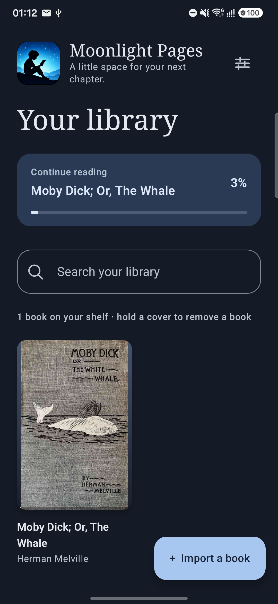
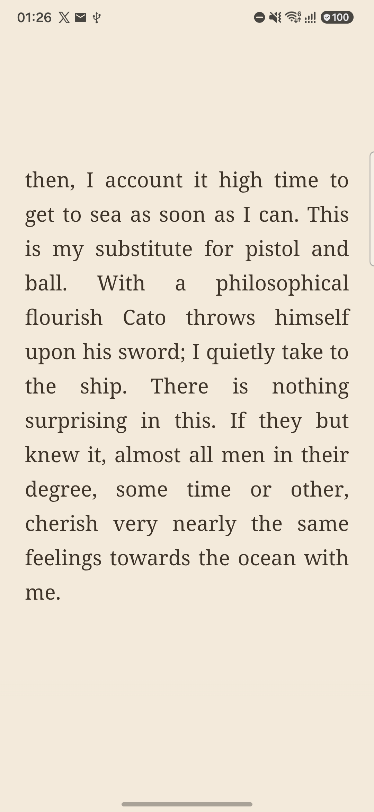
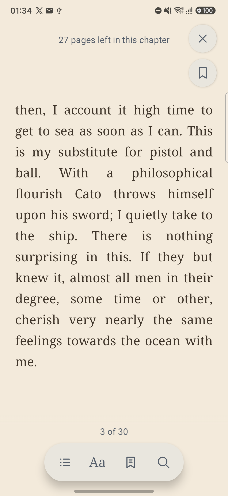
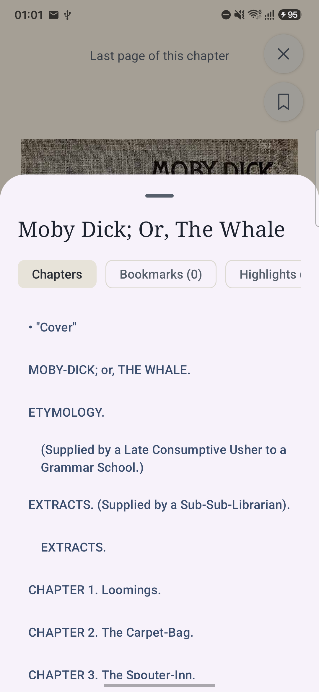
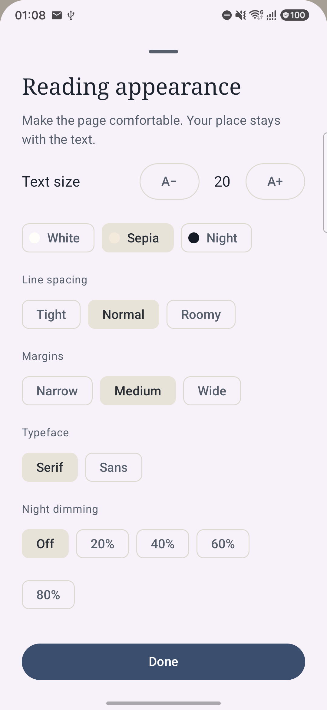
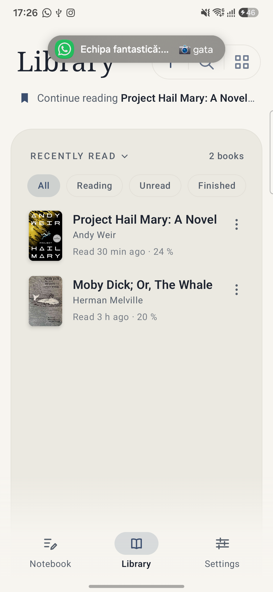

# Moonlight Pages

A small, quiet ebook reader for Android. One page at a time: no scrolling, no feeds, no account,
no network permission. Kotlin and Jetpack Compose.

| Library | Reading | Controls |
| :---: | :---: | :---: |
|  |  |  |
| **Contents** | **Reading appearance** | **Light theme** |
|  |  |  |

## Install

Download the signed APK from [Releases](https://github.com/cristifcp/MoonlightPages/releases), open it on the phone and allow the
installer to install from that app once. Android 8.0 (API 26) or newer.

Each release is built from its tag by this repository's own workflow and signed with the same key
every time, so updates install over the previous version and keep your library. The signing
certificate's SHA-256 fingerprint is:

```
20:28:6E:9D:D2:13:18:D4:4A:B2:80:99:4F:48:1D:2D:6D:69:17:FC:B9:A7:1A:E7:C4:EA:1D:27:35:17:77:FE
```

You can check it before installing with `apksigner verify --print-certs app-release.apk`, or build
the app yourself from the sources below.

## What it is

Most readers are built to sell you something. This one is built to be read: a page of paper, one
screen at a time, with the book's own words set the way you like them. Everything lives on the
device. The app has no internet permission at all, so nothing can leave it, and a backup is only
ever written where you point it.

The shelf, the reading positions, bookmarks, highlights and notes are all kept in the app's own
storage and can be carried to another phone in a single zip.

## Features

**Reading**

- One page at a time, turned by a swipe or by tapping the left and right edges — you pick which,
  and the two never compete for the same touch. A swipe acts when the finger is lifted, so the
  page never drags along under it.
- A turn that reads like paper: the arriving page travels in from the edge of the screen, over the
  page being left, which darkens under its shadow and slips aside.
- The page and nothing else while you read. Tap the middle for a hint of controls: where you are in
  the chapter, the page number, and Contents, **Aa**, Bookmarks and Search.
- Text size, line spacing, margins and typeface (serif or sans), applied to the page already open.
- White, sepia and night paper; night dimming that takes the screen's own brightness down, below
  what the phone normally offers.
- A daylit theme and a moonlight one for everything around the page, either explicitly chosen or
  following the phone.

**The shelf**

- A shelf kept in rows — cover, title, author and when the book was last put down — with the covers
  one tap away, and an order to choose: most recently read, title, or author.
- Each row says how far in you are, and the shelf can be narrowed to what you are reading, what you
  have not opened, and what you are finished with.
- Title and author search, a single **Continue reading** line at the top, and a **Finished** mark on
  the last page.
- Three rooms along the foot of the screen: **Notebook**, **Library** and **Settings**.
- Books arrive from the file picker, from **Open with**, or by sharing a file to the app. Imported
  copies live in the app's own storage; the file you imported is never touched.
- Remove a book from its row's menu, or by holding the row: it takes the imported copy, its reading
  place, bookmarks, highlights and notes with it, and nothing belonging to any other book.
- A whole novel comes with the app, so there is something to read before importing anything:
  *Moby Dick; Or, The Whale*, as a real Project Gutenberg EPUB.

**Marks and search**

- Whole-book search, listing each match with the words around it and the book's own chapter name;
  tapping a result reopens that passage.
- Highlights in yellow, mint, rose or lavender, notes on a marked passage, and bookmarks — each
  listed under the chapter name the book gives it, in **Contents**.
- A notebook that gathers every note from every book, where a note can be rewritten or dropped and the
  whole notebook saved as a Markdown file.
- Reading places are anchored to the text, so changing the font or the screen size keeps your place
  in the words.

**Backup**

- **Settings → Back up your library** writes one zip: the shelf, the books themselves, every
  reading place, bookmark, highlight, note and setting. Restoring only ever adds — a book already on
  the shelf is left alone, a reading place moves only when the backup's is further along, and a note
  written since is never taken back.

## Formats

A book is read from what it actually contains, not from its file extension: a zip is an EPUB, an
XML file with a `FictionBook` root is an FB2, and a Palm database marked `BOOKMOBI` is a MOBI.

| Format | How it is read |
| --- | --- |
| **EPUB** 2 and 3 | As it is: the book's own package, chapters, covers and navigation. |
| **FictionBook (FB2)** | Converted at import into the same shape as an EPUB: a chapter per titled section, a contents list, images and linked footnotes. Works with UTF-8 and windows-1251. |
| **MOBI** (PalmDOC) | Converted at import: records decompressed (plain, back-references, raw runs and the space-plus-letter code), split at the book's page breaks, with pictures and cover. |

Not read, and refused with a plain explanation rather than half-read: **DRM-protected** books,
**AZW3** (a different structure inside a MOBI container, recognised by its own mark and refused by
name rather than arriving as an empty book), MOBI files compressed with Amazon's Huffman dictionary,
a MOBI whose header claims more text than the file could hold, encrypted fonts, and fixed-layout or
scripted EPUBs. Calibre converts all of these to EPUB, which this app reads.

## Build

You need Android Studio (or a JDK 17+ and the Android SDK) and a phone or emulator running Android
8.0 (API 26) or newer. The project compiles against API 37.

```bash
git clone https://github.com/cristifcp/MoonlightPages.git
cd MoonlightPages

# Build the app
./gradlew :app:assembleDebug

# Install it on a connected device
adb install -r app/build/outputs/apk/debug/app-debug.apk
```

Or open the folder in Android Studio and press **Run**.

## Tests

```bash
./gradlew :app:testDebugUnitTest      # 114 unit tests, no device needed
./gradlew :app:lintDebug              # Android lint
./gradlew :app:connectedDebugAndroidTest   # 145 tests on a connected phone or emulator
```

> **Careful with the device tests:** Android's instrumented-test task installs the app, runs the
> tests and, by default, **uninstalls it afterwards** — which erases the library of the phone you
> run it on. `gradle.properties` sets `android.injected.androidTest.leaveApksInstalledAfterRun=true`
> so the app and its data stay put. Keep that line. Android's own cloud backup is off on purpose
> (`allowBackup="false"`), so **Settings → Back up your library** is the way to keep a library.

The tests that matter most are the import ones: hand-built EPUB, FictionBook and MOBI files are put
through the real import path and the result is read back, so a format can break loudly instead of
quietly.

## Privacy

No account, no analytics, no ads, and no network permission. Books, reading places, bookmarks,
highlights, notes and settings stay in the app's private storage. A backup goes wherever you send
it and nowhere else. Uninstalling the app deletes its imported copies and marks — which is what the
backup is for.

## Status and limits

This is a working reader, developed and used as a daily driver, not a finished product. Known
limits: the page is rendered by Android's WebView with the app's own pagination code (not Readium
yet); page numbers count within the file being read, while the chapter name and the pages-left hint
follow the book's own chapters; search matches within one paragraph, so a phrase split by italics
may not be found; there is no PDF and no text-to-speech. The long version of every decision is in
[docs/DESIGN.md](docs/DESIGN.md).

## License

[GNU General Public License v3.0](LICENSE). You may use, study, share and modify this app; if you
distribute it or a modified version, the source has to stay open under the same license.

## Credits

- *Moby Dick; Or, The Whale* by Herman Melville, from [Project Gutenberg](https://www.gutenberg.org/ebooks/2701),
  is bundled with the app so the shelf is never empty.
- The reader icon and the mark in the library header are part of this project's artwork.
